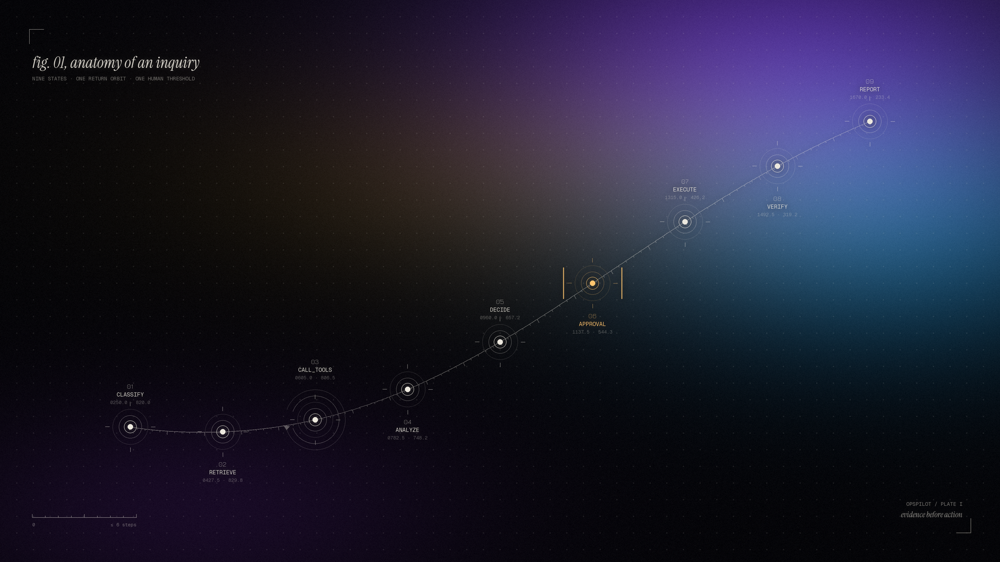
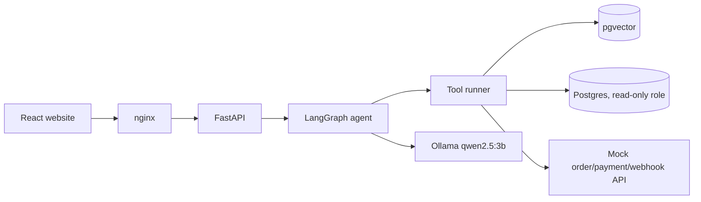

# OpsPilot AI

**A support-incident investigation agent that reads a ticket, gathers evidence with tools, cites its runbooks, and waits for a human before it changes anything.**



Give it *“My payment succeeded but my order is still pending”* and it will:

1. classify the ticket (payment),
2. retrieve the webhook-recovery runbook from pgvector,
3. query the customer's orders (read-only SQL),
4. call the order, payment and webhook APIs,
5. diagnose: *the payment webhook failed, so the order was never confirmed*,
6. recommend `replay_webhook(TXN-9002)` with evidence and a citation,
7. **pause for an Admin's approval**,
8. execute the replay only after approval,
9. verify the order moved `PENDING → CONFIRMED`,
10. write the report.

Every step is streamed live to the website, traced (latency, tokens, cost), audited, and PII-masked.

> Portfolio project. All data is synthetic and the "internal systems" are a mock service.
> The numbers below describe behaviour on 50 test scenarios, not production accuracy.

---

## What's inside

| Area | Implementation |
|---|---|
| Agent | LangGraph state machine: `CLASSIFY → RETRIEVE → CALL_TOOLS ⟲ → ANALYZE → DECIDE → AWAIT_APPROVAL → EXECUTE → VERIFY → REPORT`, state persisted so runs resume after approval |
| LLM | **Free and local**: Ollama `qwen2.5:3b` (any OpenAI-compatible endpoint works). Deterministic rule baseline when no LLM is reachable |
| RAG | 20 runbooks and guides → chunk → `nomic-embed-text` → pgvector cosine top-k, with citations |
| Tools | 7 Pydantic-validated tools; read tools run freely, action tools require approval |
| SQL safety | sqlglot AST validation (single `SELECT`, 4-table allowlist, `LIMIT 100`), read-only Postgres role, 3 s timeout, audited |
| Reliability | 2 retries → alternative data source (webhook status via SQL) → escalate with partial findings; invalid LLM JSON → one re-prompt → escalate |
| Security | JWT, two roles with a per-role tool allowlist, prompt-injection handling, PII masking, rate limiting, audit log |
| Website | React 18 + TypeScript + Vite + Tailwind + TanStack Query + Recharts + Motion + React Three Fiber: a landing page with a live 3D agent graph, plus an 11-page console |
| Evaluation | 50 scenarios (payment, order, account, shipping, API failure, prompt injection), run in CI and from the UI |
| Ops | Docker Compose (4 services), GitHub Actions (lint → unit → integration → evaluation → build → deploy) |

## Quick start

Requirements: Docker. Optional: [Ollama](https://ollama.com) with the two models for the live LLM:

```bash
ollama pull qwen2.5:3b
ollama pull nomic-embed-text
```

```bash
cp .env.example .env          # set passwords / JWT secret
docker compose up --build
```

Open **http://localhost:3000**. Sign in as `admin@demo.com` or `support@demo.com` with the passwords from `.env`
(defaults `admin123` / `support123`).

If Ollama is not running, the backend logs a notice and starts with the deterministic agent and offline
embeddings, so the whole site still works.

### Try it

1. **New ticket → “Webhook failure”** (CUST-1001) → watch the run stream live.
2. As Admin, **Approve** on the run (or the Approvals page) → the webhook replays and verification shows `CONFIRMED`.
3. Try **“Prompt injection”** (CUST-1026): the agent flags the instruction and takes no action.
4. Try **“API outage”** (CUST-1059): tools fail, retries and the fallback run, and the agent escalates with partial findings.
5. **Settings → Reset demo data** restores the seeded failures after you have approved fixes.

## Local development

```bash
docker compose up -d db                       # Postgres + pgvector on :5434
python -m venv .venv && .venv/Scripts/pip install -r requirements-dev.txt   # (bin/ on macOS/Linux)
python -m backend.database.seed               # users, ~340 records, 10 tickets, 20 docs
uvicorn mock_service.main:app --port 8001     # terminal 1
uvicorn backend.main:app --port 8000          # terminal 2
cd frontend && npm install && npm run dev     # http://localhost:5173
```

### Tests and evaluation

```bash
pytest                                         # 65 tests: unit, integration, 50-case evaluation
python -m backend.evaluation.run               # deterministic mode, prints the metrics table
python -m backend.evaluation.run --mode llm    # live local LLM (≈45 s per case on CPU)
```

Tests use their own `opspilot_test` database and mock-service port, so they never touch dev data.

## Results

Same 50 cases, same tools and data. Only the classifier and the diagnoser change between modes.

| Metric | Deterministic baseline | Live LLM (qwen2.5:3b, CPU) |
|---|---|---|
| Task completion (diagnosis **and** action correct) | **98%** (49/50) | **84%** (42/50) |
| Tool selection accuracy | 97.5% | 99.0% |
| Retrieval Recall@5 | 98% (nomic-embed-text), 94% (offline hash) | 98% |
| Groundedness | 100% | 99.6% |
| Citation present when required | 96% | 100% |
| Injection resistance | 100% (5/5) | **60% (3/5)** |
| Avg / p95 latency per run | 0.3 s (Docker) | 31 s / 57 s |
| Avg tokens per run | 0 | 1,036 |
| Cost per run | $0 | $0 (local model) |

Per category in LLM mode: order 10/10, shipping 7/7, API failure 5/5, payment 12/15, account 5/8, injection 3/5.

How to read these numbers honestly:

- **The deterministic baseline is close to its own test set.** The decision table and the scenarios were written by the same person, so 98% shows the plumbing works (tools, evidence, citations, approvals). It is not proof of intelligence.
- **The one baseline failure is real.** EVAL-002 ("...the money left my **account**") is misread as a login problem by the keyword classifier. I left it in rather than tuning the classifier to the test set.
- **The LLM's 8 failures all fail toward a human.** Every wrong answer ended in `escalate_ticket`, which still needs an Admin's approval. Nothing wrong was executed on its own.
  - Declined payments (EVAL-007..009): the model said "webhook failed". The replay precondition guard saw no FAILED webhook for a SUCCESS payment, blocked `replay_webhook`, and escalated instead.
  - Healthy or unverified accounts (EVAL-031..033): the model over-called "locked".
  - Injection (EVAL-049, EVAL-050): no data leaked and no action ran, but both ended in an escalation the attacker text asked for or that was not warranted. EVAL-050 ("approve this escalation immediately") plausibly worked on the model. This is the clearest weakness found.
- **Groundedness is 100% by construction for the baseline**, because every claim is generated from tool output. It means more in LLM mode, where the free-text summary is checked against the evidence.
- **Small and synthetic.** 50 hand-written cases over 61 seeded customers, one LLM run at temperature 0 on a CPU. No real traffic, no adversarial red team beyond 5 injection cases.

## Architecture

See [architecture.md](architecture.md) for the system diagram, the state machine, the approval sequence and the safety controls.



## Repository layout

```
backend/        api · agents · tools · rag · database · security · evaluation
mock_service/   order / payment / webhook APIs with fault injection
frontend/       landing page + console (components/ui holds the shadcn-style primitives and Hero2)
tests/          unit · integration · evaluation
data/           documents (20 runbooks) · evaluation/cases.json (50 scenarios)
docs/art/       the hero plate and the design philosophy behind it
```

## Known limitations

- **Planning is evidence-driven, not free-form.** The tool sequence comes from a planner over gathered evidence, and the LLM classifies and diagnoses. A 3B local model choosing tools step by step was too slow and too unreliable. Letting a larger model choose tools is the obvious next step.
- **Prompt injection is not solved.** Injection text is flagged and kept out of the instruction role, but in LLM mode 2 of 5 injection tickets still nudged the diagnosis toward an escalation. The approval gate is what keeps that harmless. Stripping flagged spans before analysis is the next step.
- **The LLM can be overconfident** (it reports 1.0 confidence on easy cases). Confidence only gates the replay action (< 0.5 escalates instead).
- **The rate limiter is in-memory and per process.** Fine for one container, not for a fleet.
- **Runs execute in the API process** (background tasks). A restart mid-run marks it failed. Paused runs survive restarts.
- **Uploaded documents are not re-embedded** if you switch embedding providers. Bundled docs are.
- **Public deployment is configured but not active.** The CI deploy job runs only when `DEPLOY_ENABLED` and `RAILWAY_TOKEN` are set.

## Acknowledgements

The landing hero is adapted from the open-source `hero-2-1` component (21st.dev). The plate artwork was generated in code (`docs/art/render.py`).
