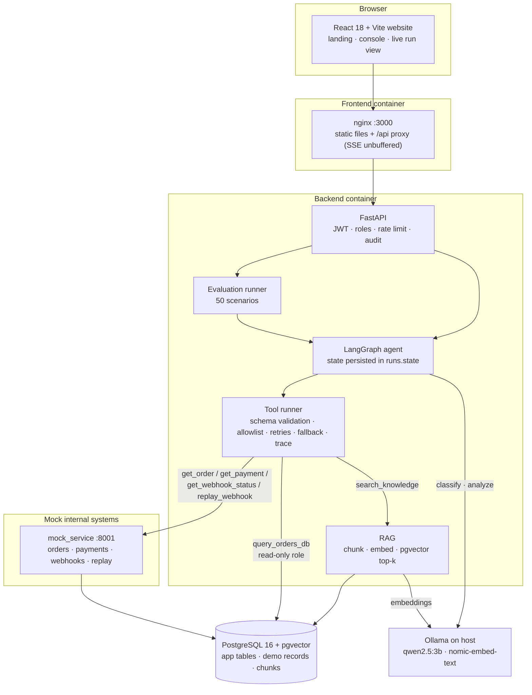
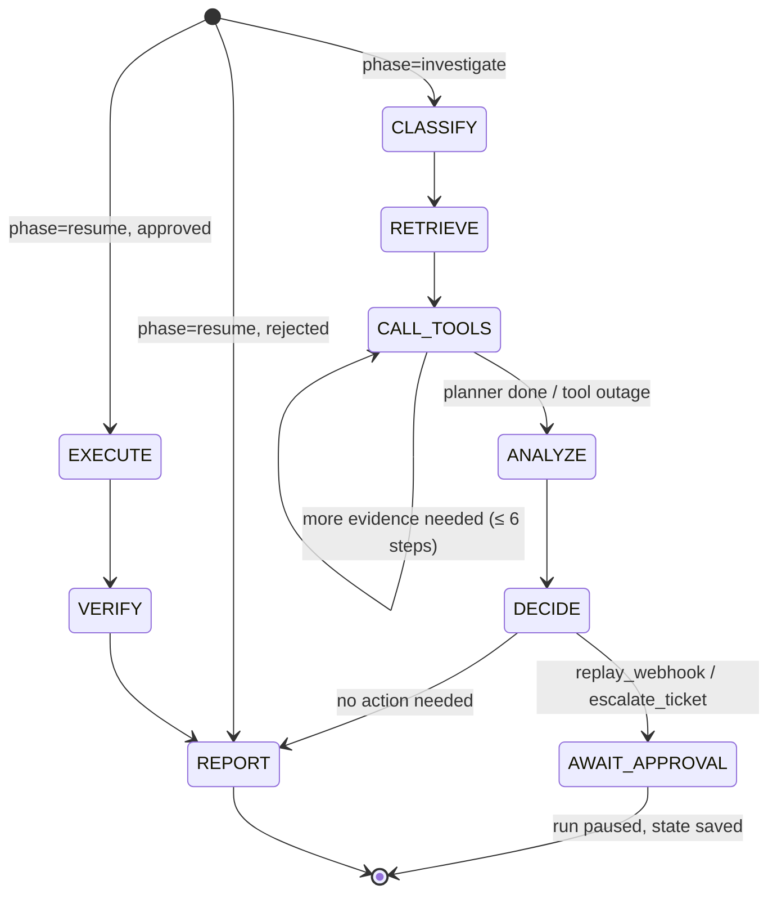
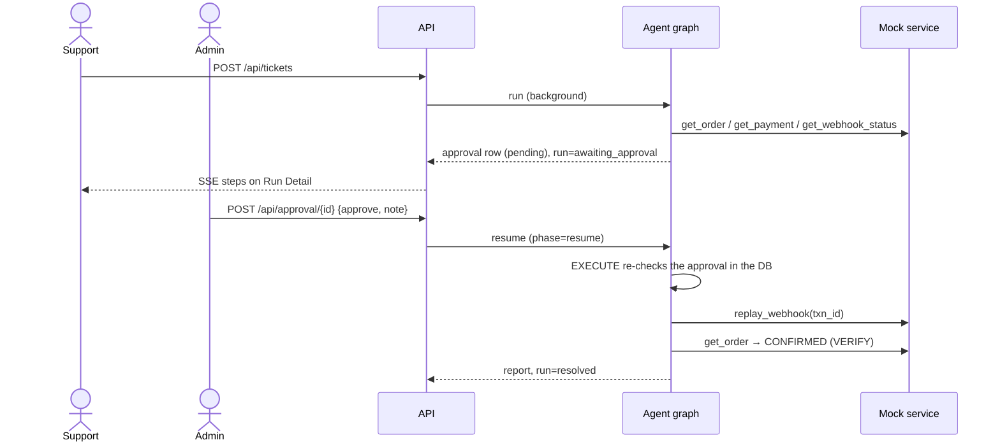

# OpsPilot AI — Architecture

## System

## Agent state machine

The graph has a conditional entry point. A paused run is resumed by invoking the same graph with
`phase=resume`, so a run survives a server restart between the pause and the decision.

| Node | Rule baseline | With the LLM (`LLM_PROVIDER=ollama`) |
|---|---|---|
| CLASSIFY | keyword scoring | JSON `{category}`; falls back to rules if the LLM is unreachable |
| RETRIEVE | top-5 chunks for `category + ticket text` | same |
| CALL_TOOLS | evidence-driven planner: orders → order → payments → webhook (account: customer row) | same; tools are deterministic so evidence is reproducible |
| ANALYZE | decision table over the evidence | JSON `{diagnosis_code, confidence, summary}` validated against the 14 known codes; invalid twice → escalate (FR-7) |
| DECIDE | diagnosis → action policy + precondition guard | same (the LLM never chooses the action directly) |

## Approval flow

## Safety controls

| Control | Where |
|---|---|
| Only `SELECT`, single statement, 4-table allowlist, forced `LIMIT 100` | `backend/tools/sql_guard.py` (sqlglot AST) |
| Read-only Postgres role, `default_transaction_read_only`, 3 s timeout | `backend/database/initdb/01-roles.sql` |
| Per-role tool allowlist | `backend/security/auth.py` `ROLE_TOOLS` |
| Action tools need an approved DB row | `backend/agents/graph.py` `execute()` |
| Replay precondition (FAILED webhook for a SUCCESS payment) | `backend/agents/graph.py` `decide()` |
| Untrusted text wrapped as `<ticket>` / `<untrusted_document>` data, injection patterns flagged | `backend/agents/reasoning.py` |
| PII masking in traces, audit entries and reports | `backend/security/pii.py` |
| Rate limiting (120/min, login 10/min) | `backend/security/rate_limit.py` |

## Data model

`users`, `tickets`, `runs` (with JSON `state`), `run_steps` (trace), `approvals`, `audit_log`,
`documents`, `chunks` (`vector(768)`), `evaluations`, plus demo systems `customers`, `orders`,
`payments`, `webhook_events`.
